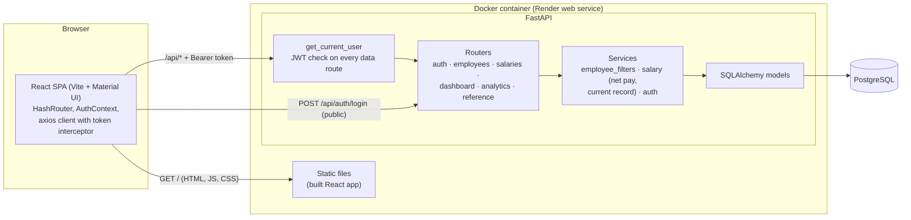
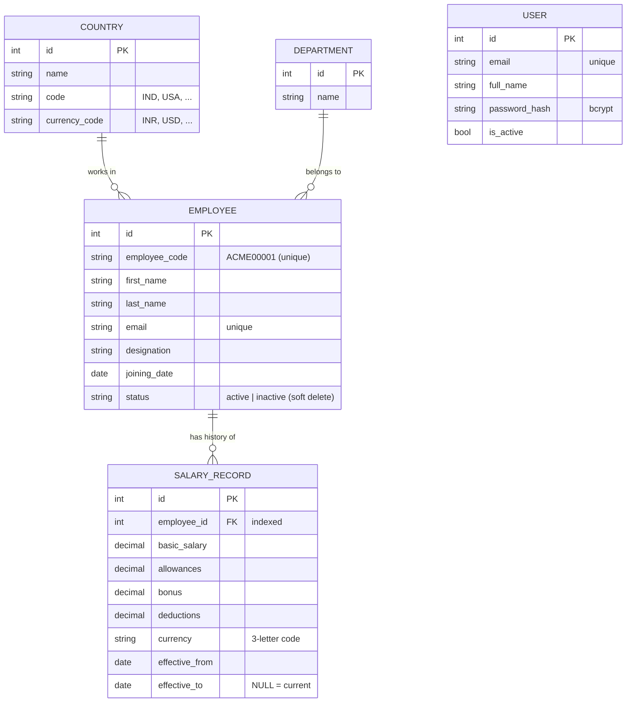
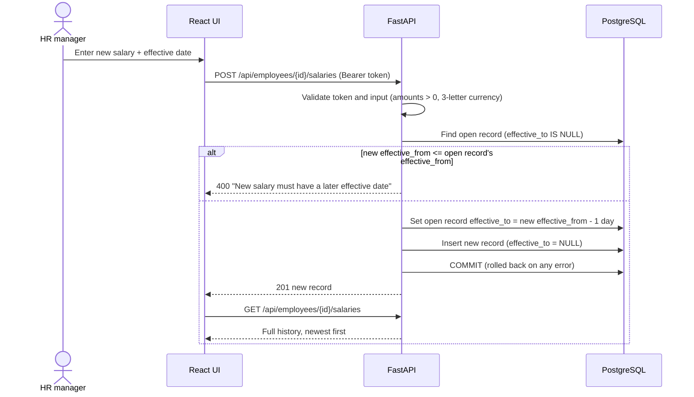
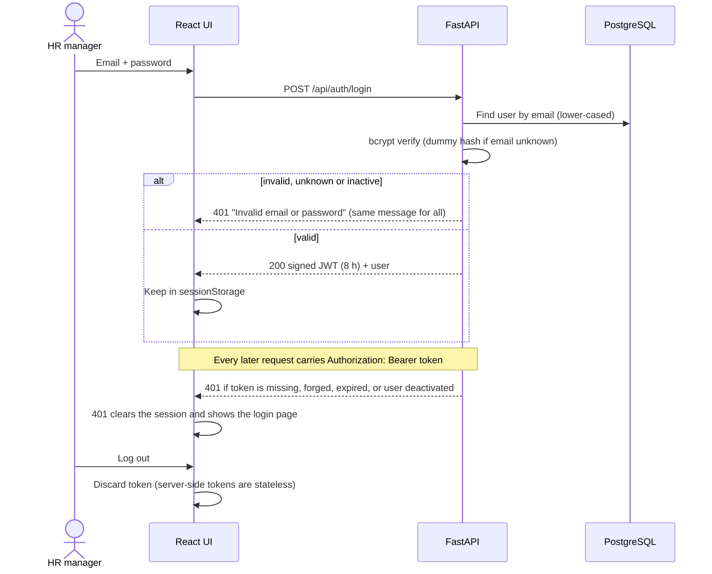

# Architecture

Diagrams are [Mermaid](https://mermaid.js.org/) and render directly on GitHub.

## 1. System overview
One deployable unit: a single Docker container serves the REST API and the built React app. PostgreSQL is the only other moving part.



**Why one container:** simplest thing to deploy and demo, no CORS configuration, one URL. The trade-off is that the UI cannot scale independently of the API; irrelevant at this size.

## 2. Data model
Salary is **effective-dated history**, not a single "salary" column. The current salary is the record whose date range contains today.



`USER` is intentionally unrelated to `EMPLOYEE`: it is a login for an HR manager, not a person on the payroll.

Indexes: `employees.department_id`, `employees.country_id`, `employees.status`, `salary_records.employee_id`, `users.email`.

## 3. Salary revision (the core business rule)
A raise never overwrites anything: it closes the open record and appends a new one, in one transaction.



## 4. Login and session


## 5. Frontend structure
```
frontend/src
├── App.jsx               routes: /login (public); everything else behind RequireAuth
├── auth/                 AuthContext (login/logout), RequireAuth guard, storage helpers
├── layout/AppLayout.jsx  dark collapsible sidebar, top-bar search, user card + logout
├── pages/                DashboardPage, EmployeesPage, AnalyticsPage, LoginPage
├── components/           StatCard, ChartCard, charts, EmployeeTable, dialogs, QuickActions
├── services/             api.js (token + 401 handling), download.js (authenticated CSV)
├── utils/format.js       currency formatting (never converts between currencies)
└── theme.js              compact MUI theme
```

## 6. Request-level rules enforced in the backend (not the UI)
| Rule | Where |
|---|---|
| Every data route needs a valid token | `include_router(..., dependencies=[Depends(get_current_user)])` in `main.py`; a test checks all 17 routes |
| Currencies are never added together | `analytics.py` and `dashboard.py` always `GROUP BY currency` |
| "Current" salary = in force today | `services/salary.py::is_current` shared by dashboard, analytics and export |
| List, count and export filter identically | `services/employee_filters.py::apply_employee_filters` |
| Salary history is never deleted | Deactivation is a status change; there is no hard delete endpoint |
